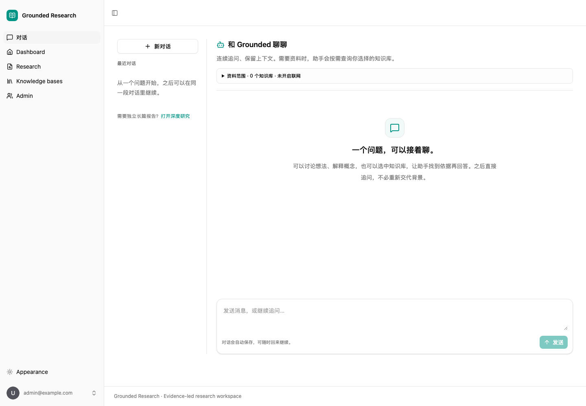

# Grounded Research

Grounded Research 是一个带私有知识库和研究工具的持续对话助手。用户在同一个聊天窗口提问、追问；主 Agent 根据当前问题与会话上下文，按需调用 RAG 子 Agent 或研究子 Agent，再给出回答与引用。

项目目录名为 `grounded-research-agent`。它整合了两个已有本地项目：企业知识库提供账户、文档、向量检索和历史存储，研究助手提供网页搜索及多步骤研究。整合方式和许可来源见 [整合说明](docs/integration.md)。



## 主入口：同一个聊天会话

- 创建会话，选择自己拥有的知识库，并决定是否允许网页搜索。
- 在 `/chat` 中连续提问，主 Agent 使用已成功完成的历史轮次和会话摘要理解后续问题。
- 需要私有资料时调用 RAG 子 Agent；需要网页或多步骤调研时调用研究子 Agent。来源选择约束可用工具，不是切换到另一个无关的应用。
- 回答通过 SSE 增量显示，工具进度与来源一并展示。重新打开会话后可以查看持久化消息，而不依赖浏览器保留上一屏。
- 同一会话一次只允许一个活动轮次。可以取消当前轮次；失败或取消的用户输入保留在界面历史中，但不会混入后续发给模型的成功对话历史。

**会话历史和摘要不等于无限、逐字准确的长期记忆。** 较早的内容会被压缩，摘要可能省略细节。精确事实应回到原消息或文档核对，不能用模型声称“记得”代替证据。

## 仍然保留的能力

- JWT 登录，以及会话、知识库、文档、消息和事件的用户归属检查。
- PDF、TXT、Markdown 文档上传、后台解析切分、智谱 Embedding、Chroma 检索与多轮知识库问答。
- 研究子流程的 Planner、Researcher、可选 Refiner、Analyst、Writer，以及 Tavily 并发子问题搜索。
- 网页和私有片段使用统一 `Evidence`，保存来源标识、正文、名称和文档或网页定位信息。
- PostgreSQL 保存会话、轮次、消息、摘要、研究结果与进度事件；SSE 支持按事件编号重读后续内容。

主 Agent 的模型工具调用与研究子 Agent 内部的固定图是两个层次。研究图不会因被作为工具调用，就自动变成任意节点都能自由调用工具的系统。

## 本地运行

默认本地运行，不需要 Docker。需要项目版本的 Python、[uv](https://docs.astral.sh/uv/)、[Bun](https://bun.sh/) 和 PostgreSQL 命令行工具（`initdb`、`pg_ctl`、`psql`）。Python 版本约束见 [backend/pyproject.toml](backend/pyproject.toml)。

在项目根目录执行：

```bash
bash scripts/setup-local.sh
```

脚本执行 `uv sync`、`bun install`，准备新的本地 `.env`，不初始化数据库。缺少系统命令时会提示安装，不会自行安装系统软件。管理员、数据库与JWT凭据为新项目单独生成；在本地 `.env` 中查看登录信息，不要将其提交到 Git，也不要复制原项目的 `.env`。

启动应用和登录无需模型 Key，实际 AI 操作需填写相应配置：

| 配置 | 用途 |
| --- | --- |
| `DEEPSEEK_API_KEY`、`DEEPSEEK_BASE_URL`、`DEEPSEEK_MODEL` | 主 Agent 对话、工具调度、摘要和研究分析写作 |
| `ZHIPUAI_API_KEY`、Embedding 地址与模型 | 文档向量化及私有知识检索 |
| `TAVILY_API_KEY` | 网页研究搜索 |

真实模型、Embedding 和搜索请求可能计费。私有文档片段及会话内容会发送到所配置的模型服务；“私有知识库”描述应用内的访问权限，不表示推理始终在本地进行。

```bash
bash scripts/start-local.sh
```

首次启动会在专用 PostgreSQL 中应用 Alembic 迁移并准备管理员账户。

| 服务 | 地址 |
| --- | --- |
| 聊天入口 | [http://localhost:5178/chat](http://localhost:5178/chat) |
| 前端 | [http://localhost:5178](http://localhost:5178) |
| 后端 OpenAPI | [http://localhost:8010/docs](http://localhost:8010/docs) |
| 专用 PostgreSQL | `localhost:55439` |

前台按 `Ctrl+C` 停止前后端。PostgreSQL 继续运行，如需停止再执行：

```bash
bash scripts/stop-local.sh
```

原项目的账户、文档、向量、历史和运行任务不会自动导入。新项目使用独立数据目录与端口。

## 执行与恢复边界

当前使用 **一个后端进程内的后台 worker**。数据库持久化消息和事件，不能恢复丢失的 Python 线程或尚未完成的模型工具循环。后端重启后，未完成轮次或研究运行会标记失败，需要重发问题；不会从中断步骤自动续跑。

同一数据库只允许一个后端进程，启动时用 PostgreSQL advisory lock 检查。不要通过增加 Uvicorn worker 或开启自动重载扩容。如果 PostgreSQL 自身重启，也应重启后端。取消需要工作流在检查点响应，已经发出的同步外部请求不保证立即停止。

更完整的运行生命周期、权限和记忆边界见 [架构说明](docs/architecture.md)。

## 验证

```bash
bash scripts/check.sh
```

检查包括使用外部服务替身的后端测试和前端构建。浏览器回归在 `frontend` 下运行 `bun run test:research`（研究与聊天共10项）；只查聊天可运行 `bun run test:chat`。结果见 [验证记录](docs/verification.md)。真实 PostgreSQL/本地 Chroma 联动测试与网络供应商测试是不同层次：前者验证本地数据流，后者仍需有效 Key 与独立验证。

本次整合未执行付费模型、Embedding 或网页搜索验证，没有测得可承诺的回答质量、延迟或吞吐指标。使用替身通过测试，不代表真实模型一定会正确选择工具、正确引用或记住全部内容。

## 聊天接口与代码入口

聊天接口前缀为 `/api/v1/assistant/conversations`，均要求登录。

| 接口 | 作用 |
| --- | --- |
| `POST`、`GET` 前缀本身 | 创建会话、列出自己的会话 |
| `GET /{id}`、`PATCH /{id}`、`DELETE /{id}` | 会话详情、配置修改和删除 |
| `GET /{id}/messages` | 持久化消息历史 |
| `POST /{id}/messages` | 发送问题并创建异步轮次 |
| `GET /{id}/turns/active` | 当前活动轮次，可空 |
| `GET /{id}/turns/{turn_id}` | 轮次状态与结果 |
| `POST /{id}/turns/{turn_id}/cancel` | 请求取消 |
| `GET /{id}/turns/{turn_id}/events?after=N` | 增量事件及游标重读 |

具体字段以当前 OpenAPI 为准。知识库接口继续位于 `/api/v1/knowledge-bases/`，独立研究接口保留在 `/api/v1/research/runs`。

```text
backend/app/
  api/routes/assistant.py           聊天 HTTP 与身份入口
  services/assistant_conversations.py
                                   会话/轮次/消息/摘要/后台执行与事件
  assistant/                       主 Agent 和子 Agent 调用
  services/knowledge_retrieval.py   带权限的检索与 Evidence
  research/                        多步骤研究子流程
  services/document_*.py           上传文件保存、解析和索引
  models.py                        SQLModel 业务表
  alembic/                         数据库迁移
frontend/src/
  routes/                          /chat 等页面
  lib/、hooks/、components/         请求、SSE解析、状态与界面
```

- [架构与执行边界](docs/architecture.md)
- [整合来源与取舍](docs/integration.md)
- [从一次聊天请求开始学习](docs/learning.md)

继承的 Docker 配置可作为容器部署基础，本地脚本是本版主要入口。生产部署还需配置 HTTPS、凭据、备份、监控和任务执行方案。

## 许可

保留原项目 MIT 许可与版权声明，见 [LICENSE](LICENSE) 和 [来源说明](docs/integration.md)。项目合并不改变已有代码归属。
