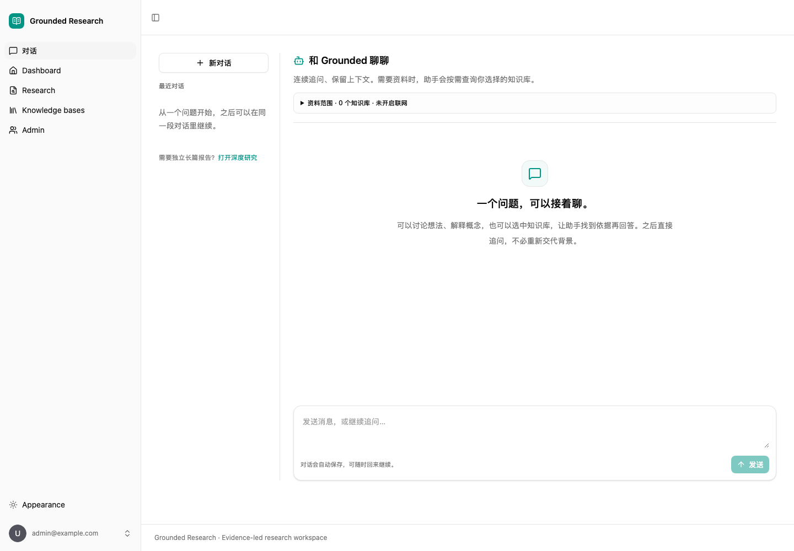

# Grounded Research

一个能查询私有文档、开展网页研究并持续追问的对话助手。主 Agent 在同一会话中调用知识问答和研究子 Agent，回答附带可追溯来源；服务重启、任务取消和外部请求失败都有明确的处理方式。

项目由已有企业 RAG 和多智能体研究项目整合而来。当前重点是把“能跑出回答”推进到“能解释权限、检索效果、执行状态和调用成本”的完整工程练习。



## 可以演示什么

- **连续对话。** 成功历史、摘要和子 Agent 笔记支持追问；来源失效后重新检查，失败或取消轮次不混入成功历史。
- **有依据的知识检索。** 先校验归属，再做词法和向量检索，通过 RRF 合并排名；提供引用、索引版本、降级提示和不调用供应商的固定评估集。
- **网页研究。** 主 Agent 按需委派 RAG、搜索或 Planner→Researcher→Analyst→Writer 研究流程，使用统一证据结构。
- **可检查的任务生命周期。** 聊天、研究和文档索引进入 PostgreSQL 队列，由独立 worker 领取；排队任务跨重启保留，运行失联明确处理为结果不确定。
- **受限的外部请求。** 主 Agent 和子任务共享调用次数、输出 Token 预留与时限；数据库记录调用层级、耗时及供应商返回的 usage。
- **标准工具入口。** 六个只读 MCP 工具复用现有 JWT 和资源权限；三个本地 Skills 按需加载文档问答、来源比较和研究规划流程。

这套实现用于学习和面试展示；录用还取决于基础、岗位和实际表达。当前验证以本地组件联动与确定性替身为主，尚未完成真实付费模型的质量与供应商兼容验收。

## 本地启动

需要 Python（版本见 [backend/pyproject.toml](backend/pyproject.toml)）、[uv](https://docs.astral.sh/uv/)、[Bun](https://bun.sh/) 和 PostgreSQL 命令行工具。本地入口无需 Docker。

```bash
bash scripts/setup-local.sh
bash scripts/start-local.sh
```

首次启动应用数据库迁移、初始化独立管理员，并启动 API、独立 worker 和前端。登录凭据保存在新项目自己的 `.env`。

| 入口 | 地址 |
|---|---|
| 聊天 | [http://localhost:5178/chat](http://localhost:5178/chat) |
| OpenAPI | [http://localhost:8010/docs](http://localhost:8010/docs) |
| 本地 PostgreSQL | `localhost:55439` |

主模型、Embedding 和网页搜索分别使用 DeepSeek、智谱和 Tavily 配置。未配置密钥也能启动并检查账户、页面和数据库；真实 AI 操作需要有效配置，可能产生费用。私有文档内容会发送到所配置的模型/Embedding 服务，应用内权限隔离不代表本地推理。

前台 `Ctrl+C` 停止应用进程；数据库另用 `bash scripts/stop-local.sh` 停止。worker 可以用 `bash scripts/start-worker.sh` 单独启动。操作与故障验收见 [运维说明](docs/operations.md)。

## 验证与学习

```bash
bash scripts/check.sh
```

各测试的环境、命令、实际结果和未验证范围见 [验证记录](docs/verification.md)。固定检索评估衡量受控样本中的排序和流程，不能当作真实模型质量分数。

- [架构：一次提问如何执行](docs/architecture.md)
- [教学：从函数输入输出逐步理解](docs/learning.md)
- [工程路线与面试演示](docs/engineering-roadmap.md)
- [MCP 与 Skills 使用](docs/mcp-and-skills.md)
- [原项目来源与整合取舍](docs/integration.md)
- [2026-10-29 官方生态与岗位核查](docs/ecosystem-research-20261029.md)

数据库保留排队意图、结果和事件。当前没有全链路 LangGraph checkpoint 续跑，也不保证供应商计费恰好一次。恢复、取消、摘要和私有查询边界见架构文档。

当前部署为单机、单个 AI worker 进程（内部有界线程池），入口会拒绝第二个 worker。队列的并发领取测试不等于整个系统已支持水平扩容；嵌入式 Chroma 还有 API/worker 跨进程访问限制，详见运维说明。上线扩容前需要替换为受支持的共享索引存储并单独验收。

保留迁入代码的 MIT 许可和版权声明，见 [LICENSE](LICENSE) 与整合说明。
