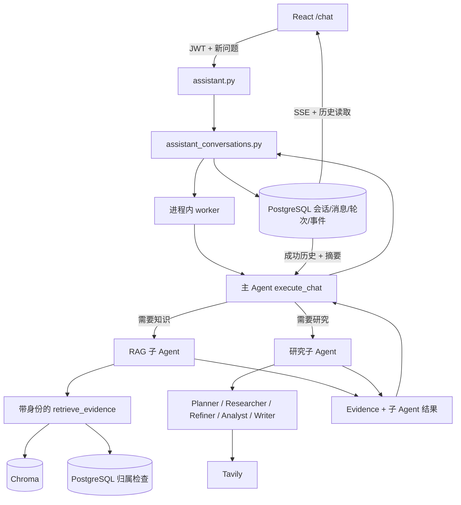

# 持续对话、子 Agent 与执行边界

应用以一个持续聊天会话为中心，主 Agent 结合当前问题、近期成功历史和会话摘要回答。RAG 和研究能力进入主 Agent 的工具边界；用户不需要在两个没有上下文关联的页面之间搬运问题。



## 1. 会话、轮次和消息是不同对象

- **会话**保存标题、允许使用的知识库、网页开关、摘要和时间。
- **轮次**表示一次用户输入对应的执行，状态为 `queued`、`running`、`succeeded`、`failed` 或 `cancelled`。
- **消息**保存显示给用户的输入与最终助手回答，并关联相应轮次。
- **事件**保存生成片段、工具进度与终态，供 SSE 增量展示和游标重读。

发送问题先保存用户消息与轮次，再让 worker 执行。成功时保存助手消息及来源，并更新轮次结果。失败或取消时保留用户输入供用户查看，但后续模型上下文排除对应失败轮次，避免把没有得到回答的输入当已完成对话。

同一会话只允许一个活动轮次。活跃期间不修改知识库或网页等会话执行配置，避免运行中改变授权来源；具体冲突响应以接口为准。

## 2. 主 Agent 和子 Agent 的职责

主 Agent 使用兼容 OpenAI 的模型工具调用处理连续对话；最多6轮模型工具调度，每轮最多执行3个工具调用。子 Agent 返回所负责的检索或研究结果。模型输出工具调用意图，实际执行仍由服务端代码完成；不能让模型自己指定另一个用户身份或越过会话允许的知识库范围。

可用工具依会话配置提供：

| 主 Agent 工具 | 执行内容 |
| --- | --- |
| `ask_knowledge(question)` | 带身份检索私有文档，再由专门RAG子模型依据片段回答 |
| `research_topic(question)` | 委派多步骤研究，返回报告与证据 |
| `search_web(question)` | 在允许网页时执行一次公开搜索 |

RAG子Agent的回答和来源元信息回到主Agent，原始文档片段不直接复制进父Agent上下文。研究子Agent的分析/报告token不直接当作最终聊天回答输出，主Agent取得结果后形成自己的回答。

研究子 Agent 的内部仍是已有 LangGraph 条件流程：

```text
Planner 拆分问题 → Researcher 并发网页搜索
→ 资料覆盖不足且有预算时由 Refiner 改写并补搜
→ Analyst 分析 → Writer 写报告
```

主 Agent 可以选择调用研究工具，不等于研究图内部每个节点都具有无限工具权限。工具轮次、子问题数量、搜索重试和外部请求超时需要分别有界。

RAG 子 Agent 依赖应用级知识检索服务。会话传下来的用户身份与知识库范围由服务端确定。原始私有检索片段不会直接传给研究Planner、Tavily查询或公共搜索缓存。这个结构不能保证所有私有信息永远不进入外部搜索：主Agent仍可能根据RAG答复或会话内容构造后续工具问题。启用网页时，生成的搜索查询会发送给Tavily；实现另有已观察私有文本的精确长串/疑似密钥重合拦截；它不是语义DLP，不能识别所有改写泄露，当前没有独立的出站审批机制。

## 3. 权限在服务端执行

`assistant.py` 使用已有 `CurrentUser` 解析 JWT，`assistant_conversations.py` 根据用户查询会话、轮次、消息和事件。用户知道会话或轮次 ID，并不代表拥有访问权。SSE、取消和删除都需要检查归属。

知识库选择与每次知识检索继续验证归属。Chroma collection 的知识库 ID 是存储隔离，不能代替授权。知识库被删除或权限变化后，不能仅因它仍在会话配置中就继续检索。

已经保存在当前用户会话里的历史回答与摘要，是该会话历史的副本；它们不会因源文件变化自动更新。应用不能将旧摘要当成“最新检索结果”，精确信息需要重新核查来源。

## 4. 近期历史与摘要

worker 读取本会话已成功完成的历史消息和已有摘要。较长历史压缩为摘要，再与近期消息一起给主 Agent，避免每轮无限增加上下文。

摘要使用 `summarized_count` 记录已覆盖的成功消息数量，仅把尚未覆盖的成功消息交给下一轮。摘要、覆盖计数和助手回答在成功落库时一起更新，失败或取消不推进摘要水位。

摘要还保存 `summary_sources`，读取历史时重新检查私有来源的归属、存在性及ready状态。旧助手消息如依赖已无权或失效的私有来源，会替换为明确的不可用占位；已有摘要依赖失效私有来源时丢弃摘要，重新从有效历史构建。更改所选知识库限制未来检索，不会直接删除仍属于用户且有效的既有会话内容。

原始历史多于16条或字符预算超限时尝试摘要，通常保留近期12条消息；摘要失败则只使用有限近期窗口并给出提示，不把未成功压缩的消息标成已摘要。摘要是模型对历史的有损压缩，可能遗漏细节、时间和否定条件；原消息仍是查询确切表达的依据。

它提供会话内连续性，不意味着跨所有会话共享记忆、无限上下文、逐字复述历史，或自动了解用户没有提交的资料。

## 5. 统一 Evidence

`services/knowledge_retrieval.py` 中项目自定义的 `Evidence` 包含：

| 字段 | 含义 |
| --- | --- |
| `source_id` | 去重与引用使用的来源标识 |
| `kind` | `knowledge` 或 `web` |
| `content` | 文档片段或网页检索内容 |
| `title` | 来源展示名称 |
| `url` | 可空，网页地址 |
| `document_id` | 可空，私有文档编号 |
| `chunk_index` | 可空，私有文档片段编号 |

格式统一，权限和来源性质仍不同。私有文档不能被虚构为公网 URL，网页 URL 也不代表该页面结论已经可靠。来源正文当作待核对资料，不能执行其中的提示指令。

Embedding 和生成由 `.env` 配置的服务提供，私有片段和对话会离开本机进入相应请求。访问隔离与本地推理是不同概念。

## 6. SSE 与重新打开页面

发送消息返回轮次后，前端通过带 JWT 的事件接口读取 `token`、`agent_update`、`complete`、`error`、`cancelled`。片段只是展示过程，最终消息从数据库重新读取。

SSE 以空行分隔事件，网络读取的一块数据可能只包含半个事件，也可能包含多个事件。客户端先缓冲、拆帧和解析，再按事件 ID 去重。`after=N` 用于只取后续记录，重读事件不会重新执行模型。

页面关闭只停止传输连接，不等于取消任务。重新打开时查询会话消息及活动轮次，再继续读取事件。完成的回答依赖数据库持久化，不依赖浏览器内存保存上一屏。

取消请求与 worker 完成需要围绕同一轮次序列化，避免“已取消”随后被迟到结果覆盖，或取消后又插入助手消息。已发出的同步外部请求通常不能立即抢占，取消会在执行检查点生效。

## 7. 单个进程与重启

当前后台任务在进程内执行。一个数据库只运行一个后端进程，启动时 PostgreSQL advisory lock 防止第二个实例误回收仍在执行的任务。自动重载或增加 worker 不在当前运行约定内。

进度和消息持久化不能恢复 Python 线程、未完成的模型工具循环或 LangGraph 节点。后端重启将遗留活动轮次/研究运行标记失败，用户重发问题；已完成会话与事件仍可查看。

数据库短暂不可用时可以只重试终态保存，不能为重试写库重新调用付费模型。若待保存结果仍只在内存，而进程同时退出，结果可能丢失。这一机制不是耐久执行、checkpoint恢复或独立任务队列。

PostgreSQL 自身重启后也应重启后端，不能假定断线前持有的 advisory lock 仍然有效。

## 子 Agent 结果如何进入后续对话

每个成功轮次除最终回答外，还保存受限大小的 `delegate_notes`（工具名、子问题、子答复和来源ID）。主Agent实际看到的子Agent结果可能包含最终回答没有复述的方案细节；下一轮把仍有权的笔记作为参考数据附到历史，而不是凭空假设模型已经记住。摘要也覆盖这些笔记。

来源展示与依赖校验有不同职责。保存真实工具涉及的私有来源，不只保存模型最终引用的来源，防止未引用的私有资料失效后仍通过旧笔记复用。旧来源失效时对应旧回答与笔记不进入模型上下文；用户自己的历史显示仍是已存档副本。笔记有大小上限，细节被省略时应重新检索。
