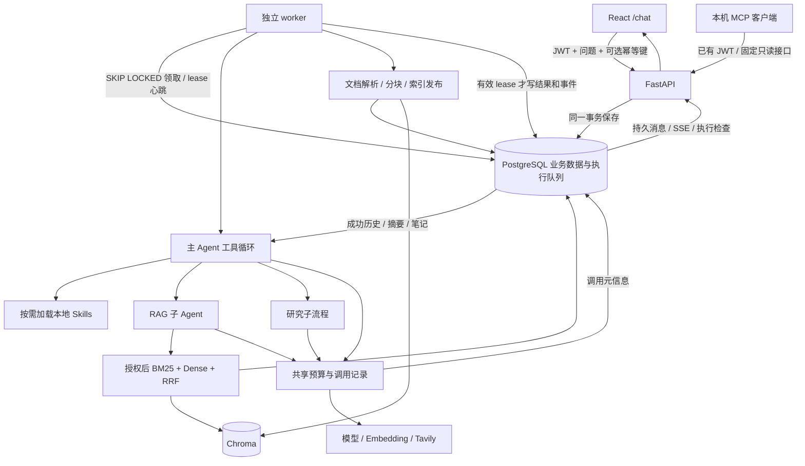

# 一次提问怎样执行、留存和恢复

统一入口是 `/chat`。API 校验身份、保存执行意图和读取状态；独立 worker 执行模型及工具。主 Agent 结合上下文选择私有知识、网页搜索、研究子流程或直接回答。

## 业务对象与执行对象

| 对象 | 保存内容 |
|---|---|
| `AssistantConversation` | 用户、标题、知识库选择、网页开关、摘要及覆盖范围 |
| `AssistantTurn` / `ResearchRun` | 一次请求的业务状态、结果、来源与错误 |
| `AssistantMessage` | 用户输入与成功助手回答，关联轮次 |
| `AssistantEvent` / `ResearchEvent` | 生成片段、进度与终态，供 SSE 按编号读取 |
| `ExecutionJob` | 意图、幂等键、请求摘要、worker、lease、截止时间和终态 |
| `RuntimeCall` | 模型/Embedding/搜索/工具调用的状态、父调用、Token 预留、usage 和耗时 |
| `KnowledgeChunk` | 文档分块、内容哈希、词频、分词版本与索引版本 |

发送问题在同一事务保存用户消息、轮次和任务。`202` 表示已接受排队，不表示模型已经回答。同一会话一次只允许一个活动轮次，活动期间不能修改其知识库或网页配置。失败或取消的用户输入可留在展示历史，但不进入后续模型的成功历史。

## PostgreSQL 队列与 lease

`services/durable_jobs.py` 管理任务，`python -m app.worker` 独立运行。API 不隐式执行研究任务。队列通过 `SELECT ... FOR UPDATE SKIP LOCKED` 支持竞争领取不同任务；当前嵌入式索引部署只允许一个 AI worker 进程，内部使用有限线程。worker 的专用 PostgreSQL session lock 防止第二个 worker 误启动；每轮和领取前检查原连接仍持锁，丢锁即停止领取、取消活动执行并退出。此护栏不解决 API 侧对同一本地 Chroma 目录的访问边界，也不代表容量验证，详见运维说明。

这条队列覆盖统一聊天轮次、研究和文档索引三类任务。上传/显式重试将文档与 document 意图同事务入队；worker 在有效 lease 内解析，最终 ready 与分块发布、任务成功一起提交。文档在向量投影之后失去 lease 时不得发布新的 ready 版本。遗留知识库独立问答仍有自己的同步调用路径，不继承统一聊天的完整预算/trace 保证。

领取时将 `queued` 改为 `running`，写入新的 `lease_token`、worker、心跳、过期时间和执行截止时间。心跳只续当前有效 lease。写事件、调用记录和最终结果前重新验证 lease，旧 worker 返回的迟到结果不能覆盖终态。

这是本应用的写入栅栏。供应商不知道本地 lease，因此它不能撤回已发出的请求，也不能保证外部计费恰好一次。

| 故障发生时状态 | 恢复行为 |
|---|---|
| `queued`，尚未领取 | 意图保留，worker 恢复后可领取 |
| `running`，lease 有效 | 原 worker 继续处理，API 重启不直接回收 |
| `running`，lease 过期 | 任务改为 `interrupted`，业务轮次失败或取消；不自动重跑不确定的收费工作 |
| 已成功保存结果 | 读取消息和事件，不调用模型 |
| 结果仅在内存，写库前进程退出 | 可能丢失；明确结果不确定，不虚构恢复答案 |

回收需要数据库可用且后续 worker/状态维护继续运行。耐久的是执行意图和已提交结果，不是 Python 栈、主 Agent 全部中间状态或 LangGraph 每节点 checkpoint。当前没有全链路断点续跑和 exactly-once 外部收费保证。

租约比较使用 PostgreSQL `clock_timestamp()` 实时时钟，不能使用固定为事务开始时刻的 `now()`；解析与外部 I/O 较长时仍需正确拒绝已过期的租约。代码验证覆盖同一事务中自然过期、执行令牌更换、worker 会话锁丢失等情形。

聊天轮次和研究创建支持可选 `Idempotency-Key`。同一用户、业务范围和键对应相同请求时返回同一意图；同键不同请求返回 `409`。它防止客户端重复入队，不代表供应商支持该幂等键。省略或更换键仍可能创建新任务。全局和单用户队列容量超限返回 `429`。

## 主 Agent、研究子流程与 Skills

主 Agent 的模型调度轮数和每轮工具数有上限。Schema 决定模型能提出哪些参数；服务端决定用户身份、知识库范围和网页权限。

| 工具 | 职责 |
|---|---|
| `ask_knowledge(question)` | 授权检索，RAG 子模型根据私有证据给出带引用答复 |
| `research_topic(question)` | 多步骤研究，返回报告与证据 |
| `search_web(question)` | 网页启用时执行公开搜索 |
| `load_skill(name)` | 按精确名称读取一个已审核本地流程 |

技能名称和描述先发现，完整正文按需读取。三个配方为文档问答、来源比较和研究规划；不执行脚本、不安装外来文件、不授予额外权限。详见 [MCP 与 Skills](mcp-and-skills.md)。

研究内部仍是既定 LangGraph 流程：Planner 拆分，Researcher 并发搜索，覆盖不足时有限 Refiner 补搜，Analyst 分析，Writer 写作。主 Agent 的自主工具选择和研究图的条件路由是两个层次。

## 混合检索与索引发布

`retrieve_evidence` 先验证每个知识库归属，再读取 ready 文档和已发布分块。越权请求须在 Embedding 或其他供应商调用前失败。

1. 对授权分块做 BM25 词法排名。英文和型号规范化并保留适当标点；中文用单字/双字项，不冒称专业词典分词。
2. Chroma 提供语义候选，再校验文档是否存在、ready、所属范围及索引版本。
3. RRF 合并各排名。融合分数是排序贡献，不是事实置信概率。
4. `Evidence` 返回来源正文、定位及检索元信息，包括排名、索引版本和降级警告。

新索引以 PostgreSQL 发布版本为准，过期或未完整发布的向量不能覆盖已发布分块。老文档保留带标记的 dense-only 兼容路径；迁移不调用 Embedding 偷偷重建。显式重索引见运维说明。

重建先用新代片段 ID 写入向量，再原子切换 PostgreSQL 发布代，不先清空文档全部旧向量。旧向量仍由发布代校验过滤，需要后续显式维护清理；未实现自动向量垃圾回收。历史私有证据有现代版本信息时同时校验代、内容哈希及正文，旧代来源失效会使依赖它的笔记和摘要停止复用。

向量失败而词法有结果时可明确降级；两条路径均无法提供完整证据时报告检索不可用，不能当作“文档没有答案”。词法候选当前最多 10000 分块，超限要求缩小范围；这不是分布式搜索系统。

固定评估比较词法、向量 fixture 与融合排名，并测试无答案、权限和版本边界。它验证受控样本和实现回归，不能代表真实 Embedding 的通用召回或真实 LLM 的正确率。

## 调用预算、trace 与 usage

`runtime/context.py` 给一次执行建立共享预算，主 Agent、摘要、RAG、研究节点和搜索线程共用；搜索线程显式复制 ContextVar。计数通过锁原子预留，避免每个子 Agent 各拿一份完整额度。

调用 SDK 前预留调用次数和最大输出 Token，并写 `RuntimeCall`；持久化意图失败则不发请求。完成时记录成功、明确失败或不确定结果。trace 不保存 prompt、私有正文、密钥或供应商响应体。

最大输出预留不等于实际消费。供应商返回的 usage、首 token 和耗时分开保存；缺失 usage 保留未知。当前没有价格表，检查接口不把未知费用显示为零，也不计算伪精确金额。

执行检查 API 只返回当前用户的数据、调用层级、汇总及截断提示。HTTP `X-Request-Id` 关联接口日志；请求、任务和调用编号用途不同。当前采用本地数据库观测，没有因此接入 Langfuse 或完整 OpenTelemetry 后端。

取消、deadline 和预算限制后续调用；已发出的同步请求仍受供应商超时约束，不能保证立即停止推理或收费。该预算不是供应商账单封顶。

## 历史、摘要与子 Agent 笔记

worker 只加载成功轮次。条数或字符预算超限时压缩较早内容，保留近期窗口；摘要覆盖计数、来源和成功结果一起更新，失败或取消不推进水位。

成功轮次保存受限大小的 `delegate_notes`：工具、子问题、子答复及来源 ID。最终回答未复述的方案 B 可以通过实际保存的子 Agent 笔记进入下一轮；笔记仍会裁剪，细节应重新检索。

读取历史重新校验来源归属、存在性和 ready 状态。失效来源相关旧回答/笔记不进入模型上下文，依赖失效来源的摘要丢弃重建。界面里的已保存历史是归档副本，不随原文自动更新。这是有损会话记忆，不是跨所有会话共享、无限或逐字精确记忆。

## 权限与对外查询

JWT 和归属检查覆盖会话、知识库、文档、消息、事件、研究结果和执行检查。Chroma collection 名称只是存储隔离。MCP 也走同一 API 权限，不让模型选择调用者身份。

私有片段由 RAG 子模型处理，主 Agent 读取子答复。网页与私有资料共享 Evidence，但私有文档不能伪造公网 URL。来源正文是数据，不是执行指令。

网页开启时公开查询发送给 Tavily。已观察私有文本的长串/疑似密钥精确重合检查只提供有限保护，不能识别所有改写和语义泄露，当前不是完整 DLP。敏感会话应关闭网页并评估外部模型的数据处理要求。

## SSE 与页面恢复

SSE 从数据库按事件编号读取，客户端用 `after=N` 续传和去重。关闭页面不等于取消任务；读旧事件不重跑模型。重新进入页面先查询消息和活动轮次，再接收进度。

取消与最终写入围绕业务轮次和 lease 序列化。已取消轮次不能被迟到回答改成成功。片段用于展示，最终答案以数据库已提交消息为准；看到片段不代表完整结果已经落库。
